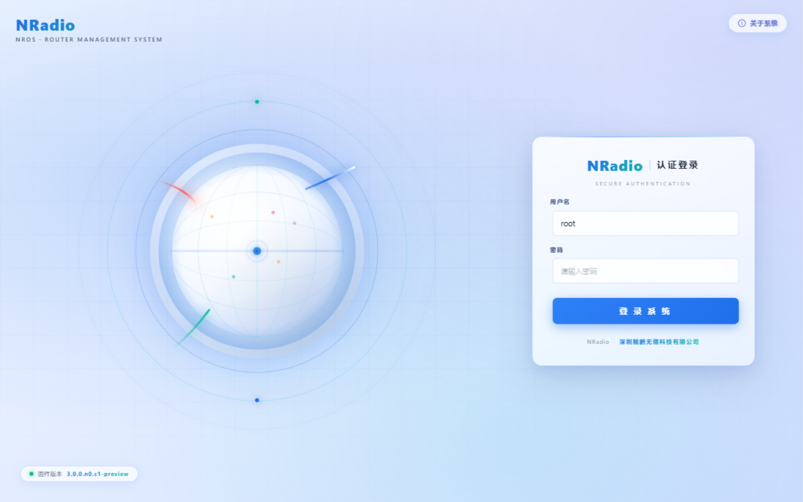
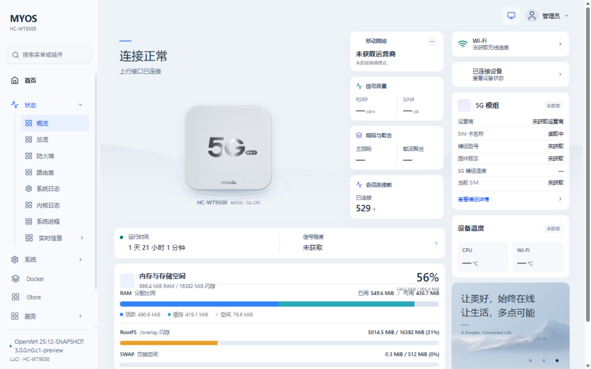

# luci-theme-manper — nradio 8080 定制 LuCI 一键部署脚本

[](https://github.com/h910056902/luci-theme-manper/blob/main/LICENSE)


## 🤔 这是什么？

本项目源自一台 nradio 固件路由器上深度定制的 **8080 端口独立 LuCI 实例**（项目代号 `manper`），
现已将其完整抽取为可分发的离线包，让**其他路由器不用刷机**，SSH 执行一条命令即可获得同款 UI：

- 🎨 **三界面可切换**：`manper 定制风格`（星空登录 + 驾驶舱）↔ `MYOS UI`（移植自 MYOS 官方主题）↔ `iStoreOS 风格`（自研：浅色卡片 + 蓝色渐变）
- 📊 **MYOS UI 仪表盘**：5G 信号（RSRP/SINR/频段 n78）、运营商、SIM 卡名称、模组型号/固件/温度、
  内存与存储、在线设备、双频 SSID、会话数、运行时间 —— 全部真实数据，10 秒自动刷新
- 🌌 **两套登录页**：星空动画页（manper）／MYOS 壁纸卡片页（MYOS UI），随主题切换
- 📶 **蜂窝网络面板**：SIM 卡管理、短信、信号详情（依赖宿主机带模组）
- 🐳 **Docker 顶层菜单**、终端 ttyd、文件管理等常用入口
- 🧩 独立于 80 端口原 LuCI 运行，**互不影响**，随时可卸载还原

## 🖥 iStoreOS 单页控制台（第三套主题）

`ui_theme=istore` 时，8080 后台是一个**外壳常驻的单页控制台**，覆盖全部页面（含 OpenClash、iStore 商店、Docker、终端 ttyd、蜂窝 / SIM / 设备）：

- **侧栏不重绘**：点任意菜单都在右侧 iframe 内无刷新换页，地址栏同步，浏览器始终只有一个页面；首屏仍走服务端渲染，不额外请求
- **一屏总览**：默认落地「仪表盘」，上行链路 / 在线终端 / 内存 / 温度四宫格，叠加连接状态、资源占用、Wi-Fi、终端与服务状态、常用入口九宫格
- **侧栏能力**：菜单搜索、常用收藏置顶（星标）、分组折叠、整栏 72px 图标栏（hover 气泡）、底部实时状态（WAN / 终端 / 负载 / 温度）
- **侧栏固定不滚动**：分组采用手风琴（一次只展开当前分组，服务端渲染时已做静态兜底），菜单区没有滚动条，所有入口常驻一屏
- **每页只有一屏**：全局紧凑布局 + 轻度等比缩放；超长页面自动切成「页内分段」导航，页面级永远不出现滚动条，单块过长时仅块内可滚动以保证内容可达
- **快捷键**：`Ctrl+K` 命令面板（搜索直达任意页面，↑↓ 选择 / Enter 打开）、`[` 折叠侧栏、`Esc` 关闭
- **安全网**：切页前拦截未保存改动；加载骨架 + 12 秒超时；异常时提供「整页打开」兜底；会话过期自动回登录页
- **嵌入模式**：iframe 内页面以 `_embed=1` 精简渲染（不带侧栏顶栏），内部链接与表单自动保持该标记；直接打开带 `_embed` 的地址会自动脱壳回完整页

切换命令：

```sh
uci set argon.@global[0].ui_theme='istore'
uci commit argon
```

> 80 端口原 LuCI 与其余两套主题（manper / myos）完全不受影响。

## 📸 预览

**manper 定制风格（默认）**



**MYOS UI（可切换，外观移植自 MYOS 官方主题包）**



> 两套主题并行安装、随时切换：8080 界面「系统 → Argon 主题设置 → 界面风格」。
> `manper` = 星空登录页 + 驾驶舱首页等定制外观；`orig` = 上游 luci-theme-argon 原版外观（紫蓝 #5e72e4、浅色经典布局）。

## 🚀 快速上手

### 1. SSH 连接到路由器，执行如下命令

```bash
sh -c "$(wget -O - https://raw.githubusercontent.com/h910056902/luci-theme-manper/main/manper.sh)"
```

或者下载后执行：

```bash
wget -O manper.sh https://raw.githubusercontent.com/h910056902/luci-theme-manper/main/manper.sh
sh manper.sh            # 交互菜单（安装 / 卸载 / 状态）
sh manper.sh install    # 直接安装
sh manper.sh uninstall  # 卸载并恢复
```

### 2. 浏览器访问

安装完成后访问：`http://<路由器IP>:8080`

> 登录账号密码即路由器的 root 管理密码。

### 常用安装选项

```bash
# 8080 端口被占用时（例如 GL 原厂固件自带 8080 LuCI），换端口安装：
MANPER_PORT=8081 sh manper.sh install

# 只监听 LAN 口 IP：
MANPER_LISTEN=192.168.1.1 sh manper.sh install

# 国内下载加速（可用任意 ghproxy 镜像前缀）：
export MANPER_DL_URL=https://ghproxy.com/https://github.com/h910056902/luci-theme-manper/archive/refs/heads/main.tar.gz
```

## 💡 支持的固件

| 固件 | 支持情况 | 说明 |
| --- | --- | --- |
| nradio 固件 | ✅ 完整支持 | 本项目宿主固件，云服务/APP 全功能 |
| iStoreOS | ✅ 可用 | UI 框架、登录页、首页可用；云相关页面依赖固件服务 |
| GL.iNet 原厂 | ✅ 可用 | 注意其自带 8080 LuCI，请用 `MANPER_PORT=8081` |
| 主线 OpenWrt | ⚠️ 需 Lua 运行时 | 需安装 `luci-base luci-lua-runtime`（Lua 版 LuCI） |
| 纯 JS 渲染固件（无 Lua LuCI） | ❌ 不支持 | 项目基于 Lua 版 LuCI dispatcher |

本项目属于 **UI/主题级部署**：不动系统分区、不刷机、不改防火墙，卸载即完全还原。

## 🎨 三主题切换（manper / MYOS UI / iStoreOS 风格）

安装后三套界面同时存在于路由器，可在 **8080 界面 → 系统 → Argon 主题设置 → 界面风格** 切换：

| 选项 | 效果 | 静态目录 | 模板 |
| --- | --- | --- | --- |
| `manper 定制风格`（默认） | 星空登录页、驾驶舱首页、mwrt 定制层（你的原始定制） | `luci-static/bootstrap/` | `view/themes/bootstrap/` |
| `MYOS UI` | **上游 MYOS 主题外观**：MYOS 侧栏 + 连接状态仪表盘 + 主题登录页 | `luci-static/c2000max-ui/` | `view/themes/c2000max-ui/` |
| `iStoreOS 风格`（自研） | 浅色底 + 白卡片 + 蓝色渐变 CTA（取自 iStore 设计语言）：侧栏分组导航、连接/资源/Wi-Fi/服务/测速总览、渐变品牌登录页 | `luci-static/istore-ui/` | `view/themes/istore-ui/` |

切换即时生效（缓存按模式分键）。命令行：

```sh
uci set argon.@global[0].ui_theme='myos'     # MYOS UI
uci set argon.@global[0].ui_theme='manper'   # manper 定制
uci set argon.@global[0].ui_theme='istore'   # iStoreOS 风格（自研）
uci commit argon
```

### iStoreOS 风格主题（自研，v3）

视觉语言取自 iStore 应用商店（`/www/luci-static/istore/style.css` 实测）：
主色渐变 `linear-gradient(144deg,#009aff,#0060ff)`、文字 `#32325d`、说明 `#8898aa`、
卡片 12px 圆角 + 双层柔和阴影、`#ecf3fe` 浅蓝底 —— 不复制任何上游代码，全部重写。

| 组成 | 文件 |
| --- | --- |
| 设计系统 | `www/luci-static/istore-ui/istore-ui.css`（token/组件/布局/旧 CBI 适配） |
| 外壳交互 | `www/luci-static/istore-ui/shell.js`（抽屉菜单/时钟/高亮兜底） |
| 外壳模板 | `view/themes/istore-ui/{header,footer,sysauth}.htm`（侧栏 + 顶栏 + 渐变登录页） |
| 首页 | `view/admin_status/istore_home.htm`（连接/资源/Wi-Fi/终端/服务/自动测速，10s 轮询） |

该模式下保留原厂调度树（`/nradio/*` 全部可用），并在侧栏注入「设置向导」与「原厂页面」分组。

### MYOS UI 是什么（外观移植说明）

界面外观取自 **[561410590/immortalwrt-by-MYOS](https://github.com/561410590/immortalwrt-by-MYOS)**
的官方主题包 `luci-theme-c2000max-ui`（Apache-2.0），1:1 复刻其视觉与 DOM：

| 层 | 上游实现 | 本项目移植 |
| --- | --- | --- |
| 页面外壳 | `ucode/template/.../header.ut` `shell.ut` `footer.ut` | `view/themes/c2000max-ui/*.htm`（等价 Lua 实现，同 DOM/类名） |
| 登录页 | `sysauth.ut` + `login.css` | `view/themes/c2000max-ui/sysauth.htm` |
| 仪表盘 | `dashboard.html` + `dashboard.js` + `data.js` | 原样使用（框架无关的纯前端） |
| 数据 | rpcd `c2000max.ui` / `qmodem`（ucode） | **Lua + ubus**：system / network / wireless / conntrack |

> 上游依赖 ucode LuCI 运行时（`/usr/share/ucode/luci` + `rpcd-mod-luci`），
> 本机是 Lua LuCI，故页面外壳与登录页做了 Lua 等价移植；静态资源与仪表盘 JS 原样使用。
> 模组/SIM/温度等卡片需要 `c2000max.ui`、`qmodem` 数据源，本机对应的 nradio 接口尚未接入，
> 卡片会显示 “—” / “未获取”（这是主题自身对缺失数据的处理方式）。

**已知边界**：MYOS UI 模式下，子页面仍走原厂 `nradio/*` 页面（原厂路由完整可用）；
上游的 `c2000max.ui`/`qmodem` 适配层为 C2000MAX + QModem 固件专属，本机（WT9500）无对应服务。


## 🗑️ 卸载

```bash
sh manper.sh           # 菜单选 3
sh manper.sh uninstall # 或直接执行
```

卸载脚本会：恢复所有被覆盖的固件侧 Lua 文件（安装时自动备份）→ 移除 8080 实例目录 → 移除 uhttpd 实例 → 清理调度缓存。

## ❓ 常见问题

**Q: 提示端口 8080 被占用？**
GL 原厂固件的 LuCI 本身就在 8080。使用 `MANPER_PORT=8081 sh manper.sh install` 换端口即可。

**Q: 安装后页面打不开？**
执行 `sh manper.sh status` 查看监听状态；或重启 uhttpd：`/etc/init.d/uhttpd restart`。

**Q: 登录后部分菜单空白/报错？**
这些页面依赖 nradio 固件的服务（蜂窝、云服务等）。其他固件上属正常现象，
可在菜单选 `2) 安装 nradio 固件侧参考控制器` 补齐页面骨架（覆盖前自动备份，可卸载还原）。

**Q: 切换到原版后白屏 / 500（`unfinished string near '"'`）？**
模板文件被转成了 **CRLF** 行尾。LuCI 的 Lua 模板解析器把 `\r` 当换行，会把 `<% %>` 生成的字符串截断。
安装脚本已内置 LF 规范化（3f 步骤），手动部署时可执行：

```sh
find /overlay/nradio-apps/openwrt-luci-8080 -name "*.htm" -exec sed -i 's/\r$//' {} +
find /usr/lib/lua/luci/view/themes/argon* -name "*.htm" -exec sed -i 's/\r$//' {} +
rm -f /tmp/luci-indexcache-argon*; /etc/init.d/uhttpd restart
```

**Q: 主题样式错乱（没有 dark.css / 壁纸）？**
若曾被指向其它路径（如已删除的测试实例）会变成断链，重新指向即可：

```sh
APP=/overlay/nradio-apps/openwrt-luci-8080
for t in argon; do rm -f /www/luci-static/$t; ln -s $APP/www/luci-static/$t /www/luci-static/$t; done
```

**Q: 国内下载脚本/离线包太慢？**
设置 `MANPER_DL_URL` 环境变量指向任意镜像（见快速上手），或将仓库 clone 到本地后把 `manper.sh` 放在仓库根目录运行（自动使用本地文件，不再联网下载）。

## 🧩 目录结构

```
luci-theme-manper/
├── manper.sh                       # 一键部署脚本（安装/更新/卸载/状态）
├── files/                          # 按目标路径镜像存放的部署文件
│   ├── overlay/nradio-apps/openwrt-luci-8080/
│   │   ├── www/cgi-bin/luci        # 8080 调度器（双模式补丁在此）
│   │   ├── www/luci-static/        # bootstrap 定制层 / c2000max-ui 主题资源 / router3d
│   │   │   └── symlinks.list       # 符号链接清单，部署时自动重建
│   │   └── usr/lib/lua/luci/view/  # 实例私有视图
│   │       ├── admin_status/       # 驾驶舱、蜂窝、短信、Docker、myos_ui 仪表盘…
│   │       └── themes/             # bootstrap(manper 外壳) / c2000max-ui(MYOS 外壳)
│   ├── usr/lib/lua/luci/view/themes/c2000max-ui/  # 宿主侧同一套主题（登录页渲染路径需要）
│   ├── usr/lib/lua/                # 固件侧依赖（nradio.lua、cloudd、nradio 控制器、argon-config）
│   ├── usr/share/rpcd/acl.d/       # argon-config rpcd ACL
│   └── etc/config.argon.default    # /etc/config/argon 默认配置（仅缺失时写入）
├── vendor-reference/               # nradio 固件侧参考控制器（高级选项手动安装）
├── res/                            # README 预览图
└── README.md
```

> `files/overlay/.../theme-backup40~42-*`、`www/cgi-bin/luci.bak-*` 等是项目演进中的历史备份档案，
> 一并保留；部署脚本会自动去掉备份脚本执行位，避免被当作 CGI 调用。

## 🛠️ 技术说明

**架构**：8080 实例 = 独立 uhttpd 节点（`/etc/config/uhttpd` 的 `openwrt8080` 段）+ 独立 docroot + 定制版 Lua CGI dispatcher（自建菜单树，复用宿主机 Lua LuCI 运行时与控制器）。

**双模式实现**（`/etc/config/argon` 的 `ui_theme` 决定，调度缓存按模式分键，切换即时生效）：

| | manper 模式 | MYOS UI 模式 |
| --- | --- | --- |
| 媒体路径 | `/luci-static/bootstrap` | `/luci-static/c2000max-ui` |
| 页面外壳 | 实例私有 `themes/bootstrap`（mwrt 定制层） | 移植的 `themes/c2000max-ui`（Lua 版 header/footer/sysauth） |
| 首页 | 驾驶舱 `admin_status/nradio_details` | 仪表盘 `admin_status/myos_ui`（移植自官方主题） |
| 菜单 | 服务端渲染 | 服务端预渲染骨架 + `menu.js` 增强（搜索/分组/音色图标） |
| 登录页 | 星空页 `nradio_8080_sysauth` | MYOS 壁纸页 `themes/c2000max-ui/sysauth` |
| 路由树 | 裁剪厂商路由（nradio/nradioadv 隐藏） | 保留原厂完整路由树 |

**MYOS UI 数据适配**（替代上游的 `c2000max.ui` / `qmodem` rpcd）：

| 数据 | 本机来源 |
| --- | --- |
| 模组 RSRP/SINR/频段/运营商/PCI/型号/固件/模组温度 | `ubus call infocd cpestatus` |
| SIM 卡名称/槽位/ICCID/流量 | 同上（`sim_name`、`simno`、`iccid`、`sim_flow`、`sim_mon`） |
| 整机 CPU/Wi-Fi 温度 | `ubus call infocd runtime` |
| 上行接口 / 内存 / 闪存 / 运行时间 | `network.interface dump` + `system info` |
| 无线 SSID | UCI `wireless`（本机无 `network.wireless` ubus 对象） |
| 在线设备数 | `/proc/net/arp` 去重 |
| 会话连接数 | `/proc/sys/net/netfilter/nf_conntrack_count` |

首页每 10s 通过 `?state=1`（仅返回 JSON）自动刷新。

**子页面统一**：`manper-subpage.css` 把 LuCI 旧控件（勾选框→胶囊开关、CBI 值行、fieldset 卡片、文本域、按钮）统一到 MYOS UI 风格；footer 补齐依赖 luci.js 的占位（本地时间）。

> 源路由器为 OpenWrt 25.12-SNAPSHOT（mediatek/filogic, aarch64; HC-WT9500 / C2000 Ultra），
> 本项目是纯 Lua / 静态资源，与 CPU 架构无关。

## 🔙 回滚

部署脚本安装时自动把旧实例备份为 `/overlay/nradio-apps/openwrt-luci-8080.bak-<时间戳>`。
若需手动回退到迁移前（老 bootstrap 底层）：

```sh
cp -a /overlay/nradio-apps/openwrt-luci-8080.bak-<时间戳>/. /overlay/nradio-apps/openwrt-luci-8080/
rm -f /tmp/luci-indexcache-argon* /tmp/luci-indexcache-bootstrap*
/etc/init.d/uhttpd restart
```

## 🗂️ 引用与致谢

本项目的开发参照/受益于以下项目，感谢这些开源项目的作者：

- [wukongdaily/gl-inet-onescript](https://github.com/wukongdaily/gl-inet-onescript) — 本仓库的脚本组织与 README 风格参照
- [jerrykuku/luci-theme-argon](https://github.com/jerrykuku/luci-theme-argon) — LuCI 主题开发的经典参考
- [istoreos/istoreos](https://github.com/istoreos/istoreos) — iStoreOS / quickstart 生态
- OpenWrt / LuCI 团队

## ⚠️ 免责声明

本项目按"现状"提供。刷写/部署前请自行评估风险，因使用本脚本造成的任何问题由使用者自行承担。部署前请确认已了解如何通过 SSH 恢复访问。

## ⭐ Star 趋势

如果本项目对你有帮助，欢迎点个 Star！

### 已知固件缺陷（非本项目引入）

`网络 → 网络诊断`（`/admin/network/diagnostics`）在**原厂 80 端口同样返回 500**：
`Model 'admin_network/diagnostics' not found` —— 固件缺少
`/usr/lib/lua/luci/model/cbi/admin_network/diagnostics.lua`。本项目未改动该文件，两种界面模式下表现一致。
